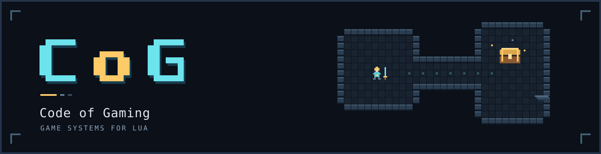

# CoG · Code of Gaming

CoG is a Lua framework for the systems that make a game work: character
progression, resources, items, equipment, targeting, cards, navigation and
moddable content. It builds on [LuaEx](https://github.com/CentauriSoldier/LuaEx),
bringing those systems together through reusable classes and components.

A creature can own its health, experience, inventory and status tracker. An item
can have rarity, affixes, an equipment footprint and rules about who can use it.
A map can charge different movement costs for different actors. You choose the
content and rules; CoG supplies the components that carry them.

[Getting started](#getting-started) · [Gameplay examples](#gameplay-examples) · [Configuration](#configuration) · [Documentation](#documentation)

## Getting started

Place the `LuaEx` and `cog` folders on your Lua module search path, keeping each
framework's scripts and subfolders together. Initialize LuaEx first:

```lua
local initLuaEx = require("LuaEx.load");
initLuaEx();

local initCoG = require("cog.load");
local CoG = initCoG();
```

This loads CoG with its bundled configuration and makes its classes and utilities
available. The returned `CoG` is the framework's class object. Its configuration
is available as `CoG.config`.

Requiring a loader returns its initializer without running it. CoG checks that
`LUAEX_INIT == true` and requires LuaEx class-load level 3 or higher; LuaEx's
default initialization includes those dependencies. Successful subsequent calls
return the same initialized class.

## Gameplay examples

### Give resources more than a current value

Health, mana, stamina and similar resources often need modifiers, regeneration,
reserved capacity and callbacks. `Pool` brings those operations into one place:

```lua
local mana = Pool(100, 75);

mana.set(10, Pool.ASPECT.RESERVED_FLAT);
mana.set(5, Pool.ASPECT.CYCLE_FLAT);
mana.cycle();

print(mana.get());                     -- 80
print(mana.get(Pool.ASPECT.AVAILABLE)); -- 90
```

The reserved amount reduces usable capacity while the cycle restores mana.
Flat and percentage modifiers let buffs and penalties affect the same pool;
events let your game respond to changes.

For character progression, `XPSystem` supports linear, logarithmic, exponential,
quadratic, cubic and stepped XP curves. It tracks cumulative experience, level
thresholds and level-change callbacks. `StatusTracker` adds game-defined effect
categories with activation, duration and expiration.

### Build items that belong in your game

`CoGItem` provides components for item permissions, durability, size, weight,
value and attachments. `SlotPattern` describes footprints. `ItemSlot`,
`ItemSlotSystem`, `ItemSystem` and `ItemStashSystem` provide individual slots,
equipment collections, inventories and tabbed storage.

The containers share eligibility, capacity and transfer rules. `CoGRegistry`
can permit classes, descendants or specific instances, with prerequisite
callbacks for contextual checks. `IEquippable` and `IConsumable` provide the
corresponding item contracts.

`Rarity` supplies configured loot levels. `AffixSystem` manages prefixes and
suffixes, their limits and event behavior. Inventory persistence reconnects
contained items, locations and attachments through LuaEx serialization; external
owners can be reattached after loading. See the
[inventory persistence guide](cog/Objects/ItemSystem/README.md).

### Describe who can target whom

`Targetor` matches groups of target types and applies immunities and interdictors.
Here, the hunter can target the ghost because its permitted group matches:

```lua
local ghost = Targetor();
ghost.Types.add({"GHOST", "UNDEAD"});

local hunter = Targetor();
hunter.Targetable.add({"UNDEAD", "GHOST"});

print(hunter.canTarget(ghost)); -- true
```

Group order does not matter. Restrictions take precedence over a permitted
match. `TagSystem` complements this with independently enabled string tags for
categorizing objects.

### Connect map data to movement

`AStar` supports weighted, layered navigation maps. Terrain aspects describe
nodes; each rover's affinities, aversions and movement resources affect travel.
Paths can be previewed and stepped through by the game.

`Tiled` reads, edits and saves TMX maps. Its helpers handle map resources and
coordinate projection, while its AStar bridge builds native navigation maps.
Even a small map can share one coordinate conversion with your game:

```lua
local map = Tiled();
map.create({
    width = 10, height = 10,
    tilewidth = 32, tileheight = 32,
});

local x, y = map.tileToPixel(2, 3);
print(x, y); -- 80, 112: the center of that cell
```

The projection helpers also support isometric, staggered, hexagonal and oblique
map grids. The `scaler` utility handles proportional UI canvas-to-viewport
scaling.

### Work with cards and chance

`BaseCard` provides shared card metadata, tags and presentation flags.
`BaseDeck` manages an ordered collection with drawing, shuffling, reversing and
snapshot iteration. Your game supplies the card effects.

```lua
local deck = BaseDeck({
    BaseCard("Flame", "A spell card."),
    BaseCard("Guard", "A defense card."),
});

deck.shuffle();

local card = deck.draw();
card.reveal();

print(card.getName());
print(deck.getCardCount()); -- 1
```

For dice and probability checks, `RNG` includes dice rolls, percentage rolls and
random choices. `Shuffler` draws from a shuffled pool without repeating within
a cycle, which is useful for turn orders and encounter selection.

```lua
local damage = RNG.rollDice(6, 2); -- Roll 2d6.

local encounters = Shuffler({"Ruins", "Merchant", "Ambush"});
local nextEncounter = encounters.pop();
```

### Keep content separate from live objects

`BaseMod` holds mod metadata and definitions. `Factorium` imports blueprints,
merges class defaults, runs validators and resolves dependency, conflict and
override rules. You can enable, replace or remove mods, finalize eligibility,
then query the definitions available to your game.

Classes declare their blueprint contracts and construct objects through
`fromBlueprint` with the runtime context they need. The host controls load order
and which capabilities mod code can access. The
[blueprint guide](cog/ModSystem/README.md) explains registration, imports and
object creation.

Shared object foundations tie these systems together. `CoGObject` supplies
metadata, rarity, tags, events and affixes. `CoGCreature` owns XP, health,
inventory, equipment, status and targeting components. `CoGAbility` provides an
ability cost and use callback; `CoGVehicle` provides configurable component slots;
`CoGStructure` provides a structure base for your own gameplay classes.

## Configuration

Keep project settings outside the framework. For this layout:

```text
Scripts/
├── CoGConfig.lua
└── Plugins/
    ├── LuaEx/
    └── cog/
        └── load.lua
```

initialize LuaEx, then select the project file with:

```lua
local initCoG = require("cog.load");
local CoG = initCoG(2, "CoGConfig");
```

The first argument counts parents above the Cog root, using the loader's source
path. The second is the config basename without `.lua`. Defaults are `0` and
`"config"`; zero selects bundled settings only.

A project config returns its overrides:

```lua
return {
    app = {name = "My game", path = {save = "saves/"}},
    Pool = {reservationMax = 0.9},
    StatusTracker = {
        CREATURE = {"HASTENED", "GUARDED"},
    },
    MyGame = CoG.purge({difficulty = "normal"}),
};
```

Ordinary tables merge recursively into existing default keys. `CoG.purge(table)`
replaces a branch in full, allowing new keys or shorter lists. `StatusTracker`
replaces its section in full so each game defines its own effect categories.
With the configuration above, a timed status looks like this:

```lua
local effects = StatusTracker(StatusTracker.CREATURE);

effects.activate("HASTENED", 2, true);
effects.cycle();
print(effects.getDuration("HASTENED")); -- 1

effects.cycle();
print(effects.isActive("HASTENED"));    -- false
```

The completed configuration is locked before the CoG class is declared.
`CoG.config` exposes that read-only table; `require("cog.config")` returns the
same reference. `TIER` lives under `CoG.config.TIER`. The
[config assembler](cog/config.lua), [bundled settings](cog/config/) and
[loader](cog/load.lua) document the remaining options.

### Scaler callbacks and optional debounce

Scalers work immediately with no timer setup. By default, each adjustment calls
Start and End synchronously. Debounce groups repeated adjustments into one
burst: Start fires once, and End fires after the latest adjustment has been quiet
for `DelayMS`. Geometry is always calculated and returned immediately.

To enable debounce globally, add this section to your project configuration.
`HostTimers` below is a placeholder for your application's timer service; replace
these two calls with its actual scheduling and cancellation functions:

```lua
return {
    Scaler = {
        Debounce = {
            DelayMS = 100,
            Schedule = function(nDelayMS, fCallback)
                return HostTimers.after(nDelayMS, fCallback);
            end,
            Cancel = function(vHandle)
                HostTimers.cancel(vHandle);
            end,
        },
    },
};
```

CoG supplies no timer dependency. `Schedule` must return a non-nil cancellation
handle and defer the callback until later, on the application's Lua thread.
`Cancel` must cancel that handle. Supply both functions or neither. A delay of
zero, or no adapter functions, keeps callbacks synchronous.

Each scaler inherits these defaults and owns its pending timers. Pass an optional
sixth constructor argument to override the delay or disable debounce:

```lua
local oScaler = scaler(1920, 1080, 1280, 720, false); -- Inherit defaults.
local oSlower = scaler(1920, 1080, 1280, 720, false, {
    Debounce = {DelayMS = 200}, -- Inherit the global adapter.
});
local oImmediate = scaler(1920, 1080, 1280, 720, false, {
    Debounce = false,
});

oScaler.setOnResizeStart(function(oSource, tEvent)
    -- Prepare for a burst of size calculations.
end);

oScaler.setOnResizeEnd(function(oSource, tEvent)
    local tSize = tEvent.Output;
    -- Apply tSize.width and tSize.height to your application here.
end);

local tSize = oScaler.adjustSize(640, 480); -- Result available now.
```

`setOnMoveStart` and `setOnMoveEnd` work the same way. Every callback receives
the scaler and an event snapshot. `Input` contains the current call's geometry;
`InitialInput` contains the burst's first geometry. `Output` is present on End.
`Screen` contains width/height; `Viewport` contains width/height/x/y. `Operation`
is `"move"` or `"resize"`, `Phase` is `"start"` or `"end"`, and `Method` names
the adjustment method.

`adjustPos` notifies move callbacks, `adjustSize` notifies resize callbacks, and
`adjust` notifies both. Move and resize have independent quiet periods, even on
the same scaler. These events describe adjustment calculations; connect native
window events through your application. A nested calculation inside a callback
returns geometry but does not recursively notify that same operation.

Settings can also change after construction:

```lua
oScaler.setDebounce({DelayMS = 150}); -- Override global defaults.
oScaler.setDebounce(false);          -- Disable for this instance.
oScaler.setDebounce(nil);            -- Restore global defaults.
local bEnabled = oScaler.isDebounceEnabled();
local tSettings = oScaler.getDebounce(); -- A detached copy.
oScaler.cancelPendingCallbacks();    -- Cancel bursts before discarding a scaler.
oScaler.setOnResizeEnd(nil);         -- Reset this callback to a no-op.
```

Changing debounce settings cancels pending bursts without firing End. Cancelled,
late or duplicate timer callbacks cannot deliver stale events. Callback and timer
adapter errors propagate to the caller (or the host timer's callback runner).
No timer is scheduled when both callbacks for an operation are unset.

Regression coverage lives in `tests/scaler_regression.lua`. From the CoG repository,
run `lua tests/scaler_regression.lua /path/to/LuaEx`, then repeat with `global`
as the final argument to exercise configuration inheritance. The LuaEx path must
point to the folder containing the `LuaEx` module directory (`LuaEx/load.lua`).

## Documentation

Individual modules contain their
API documentation alongside the implementation:

- **Characters and resources:** [Pool](cog/Pool.lua),
  [XPSystem](cog/XPSystem.lua), [StatusTracker](cog/StatusTracker.lua).
- **Items and loot:** [item modules](cog/Objects/ItemSystem/),
  [Rarity](cog/Rarity.lua), [AffixSystem](cog/AffixSystem.lua),
  [CoGRegistry](cog/CoGRegistry.lua), [item interfaces](cog/Interfaces/).
- **Maps and presentation:** [AStar](cog/AStar.lua), [Tiled](cog/Tiled.lua),
  [map helpers](cog/tiled/), [scaler](cog/scaler.lua).
- **Cards, targeting and selection:** [card modules](cog/CardSystem/),
  [Targetor](cog/Targetor.lua), [TagSystem](cog/TagSystem.lua),
  [RNG](cog/RNG.lua), [Shuffler](cog/Shuffler.lua).
- **Content and object foundations:** [mod system](cog/ModSystem/),
  [blueprint interface](cog/ModSystem/IBlueprintable.lua),
  [object classes](cog/Objects/), [CoG class](cog/CoG.lua).

CoG is released into the public domain under the [Unlicense](LICENSE), for
commercial and non-commercial projects.
